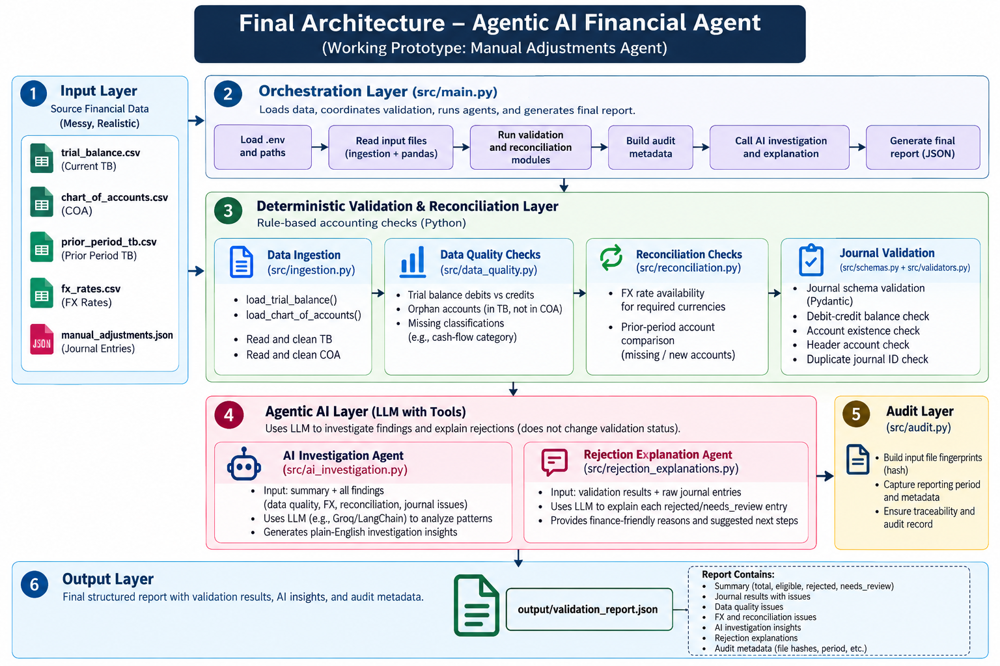

# ERP Financial Agent

**LLM-assisted financial validation and investigation using Python, LangChain, and Groq.**

ERP Financial Agent is a prototype that validates manual journal adjustments, detects financial data-quality issues, checks reconciliation gaps, and explains rejected journal entries in plain English for finance users.

The system combines deterministic accounting rules with LLM-generated explanations while preserving human oversight.

## 1. Key Features

### Deterministic Validation
- Validate journal-entry structure using Pydantic.
- Detect debit-credit balance violations.
- Flag accounts missing from the Chart of Accounts.
- Detect attempts to post to header accounts.
- Identify duplicate journal IDs.
- Flag suspicious intercompany entries for human review.

### Financial Data Quality and Reconciliation
- Check Trial Balance account references and debit-credit totals.
- Flag missing cash-flow classifications.
- Identify missing period-end FX rates.
- Flag accounts present in the prior-period Trial Balance but absent from the current period.
- Generate SHA-256 input fingerprints and a run fingerprint.

### LLM-Powered Investigation
- Integrate Groq models through LangChain's `ChatGroq`.
- Generate journal-specific rejection explanations.
- Explain validation findings in plain English.
- Recommend investigation steps and identify supporting evidence requirements.
- Provide deterministic fallback explanations when the LLM is unavailable.
- Keep AI recommendations separate from accounting validation decisions.

## 2. Architecture


---

The deterministic engine decides validation status. The LLM explains findings but does not approve journals, modify financial balances, invent exchange rates, or post entries to an ERP system.

## 3. Technology Stack

| Technology | Purpose |
|---|---|
| Python | Core application logic |
| pandas | CSV ingestion and data-quality checks |
| Pydantic | Journal schema validation |
| LangChain | LLM orchestration |
| `langchain-groq` | Groq model integration |
| `python-dotenv` | Load API configuration from `.env` |
| pytest | Automated testing |
| JSON | Validation and investigation reports |

## 4. Project Structure

```text
erp-financial-agent/
├── data/
│   ├── trial_balance.csv
│   ├── chart_of_accounts.csv
│   ├── manual_adjustments.json
│   ├── prior_period_tb.csv
│   └── fx_rates.csv
├── src/
│   ├── schemas.py
│   ├── ingestion.py
│   ├── validators.py
│   ├── data_quality.py
│   ├── reconciliation.py
│   ├── audit.py
│   ├── ai_investigation.py
│   ├── rejection_explanations.py
│   └── main.py
├── tests/
│   ├── test_validators.py
│   ├── test_data_quality.py
│   ├── test_reconciliation.py
│   └── test_rejection_explanations.py
├── docs/
│   └── architecture.md
├── output/
│   └── validation_report.json
├── .env.example
├── .gitignore
├── requirements.txt
├── reflection.md
└── README.md
```

This is the intended structure; optional files may vary depending on the local project.

## 5. Setup

### Prerequisites
- Python 3.11 or later, subject to dependency compatibility.
- A Groq account and API key for live LLM explanations.
- The required source files in `data/`.

### Install dependencies

Activate your virtual environment and run:

```powershell
python -m pip install -r requirements.txt
```

Ensure `requirements.txt` includes the project's direct dependencies:

```text
pandas
pydantic
pytest
langchain-core
langchain-groq
python-dotenv
```

### Configure the Groq API

Create a `.env` file in the project root:

```dotenv
GROQ_API_KEY=your_actual_groq_api_key
GROQ_MODEL=openai/gpt-oss-20b
```

Replace the placeholder with your own API key. Confirm that the configured model is available to your Groq account.

Never commit `.env` or expose your API key. The `.env.example` file should contain placeholders only.

## 6. Run the Application

From the project root:

```powershell
python -m src.main
```

The application reads the source files, validates journal entries, performs data-quality and reconciliation checks, and writes the report to:

```text
output/validation_report.json
```

The report includes:
- Journal validation summary and individual results.
- Trial Balance data-quality findings.
- FX and prior-period reconciliation findings.
- Audit metadata.
- LLM investigation output, when available.
- Journal-specific rejection explanations.

If the LLM request fails, deterministic validation results and fallback explanations should remain available.

## 7. Run Tests

```powershell
python -m pytest -v
```

### Verified test results

The latest reported test run showed **13 tests passed**.

Coverage includes:
- Balanced and unbalanced journal entries.
- Unknown account detection.
- Intercompany review flags.
- Trial Balance data-quality checks.
- Missing FX-rate detection.
- Prior-period account reconciliation.
- Rejection explanation fallback behavior.
- Exclusion of eligible journals from rejection explanations.

Passing tests establish that the tested cases behave as expected; they do not guarantee complete accounting correctness or eliminate LLM hallucinations.

## 8. Sample Results

The latest shared application run reported:

| Journal validation status | Count |
|---|---:|
| Total entries | 10 |
| Eligible | 7 |
| Rejected | 2 |
| Needs human review | 1 |

The supplied sample data also produced these findings:

- Account `9999` was missing from the Chart of Accounts.
- Trial Balance credits exceeded debits by `$4,800`.
- Journal `JE-002` was unbalanced by `$3,500`.
- Journal `JE-005` referenced unknown account `6315`.
- The period-end GBP rate for `2024-Q4` was missing.
- Account `6905` appeared in the prior-period Trial Balance but not in the current one.
- Multiple accounts had missing cash-flow classifications.
- Journal `JE-008` was flagged for intercompany review.

These are validation findings requiring appropriate review, not proof that every underlying transaction is incorrect.

## 9. Journal Rejection Explanations

The `src/rejection_explanations.py` module generates an explanation for each rejected journal.

For example, `JE-002` was rejected because its debit total was `$28,500` while its credit total was `$25,000`, leaving a difference of `$3,500`.

A finance-user explanation identifies the validation issue, states the observed difference, and recommends reviewing the journal lines and supporting documentation.

For `JE-005`, the system identifies that account `6315` is absent from the Chart of Accounts. The correct next step is to verify the approved account master and supporting evidence—not to add or remap the account automatically.

LLM-generated explanations are recommendations and must be reviewed by an authorized finance user.

## 10. Auditability and Safety

- Input files are fingerprinted using SHA-256.
- Deterministic validation results are kept separate from LLM-generated explanations.
- LLM output does not determine whether an entry is eligible or rejected.
- Missing FX rates are not invented.
- Journal entries are not automatically corrected or posted.
- API secrets must be protected.
- Only authorized data should be sent to an external LLM provider.

## 11. Limitations

This is a focused prototype, not a complete financial reporting platform.

- Complete balance sheet, income statement, and cash-flow statement generation is not implemented.
- ERP posting and approval workflows are not implemented.
- Intercompany detection is heuristic-based rather than full entity-level reconciliation.
- Missing cash-flow classifications are flagged but not automatically inferred.
- Prior-period account differences are not automatically resolved.
- LLM-generated explanations may be inaccurate and require human review.
- Production use would require stronger controls, monitoring, access management, broader tests, and robust handling of malformed or missing files.

## 12. Future Improvements

- Add structured output validation for LLM explanations.
- Add tests for LLM provider errors, timeouts, and malformed responses.
- Add source-line references to rejection explanations.
- Implement approval workflows and controlled ERP integration.
- Add validated financial statement generation and statement-level reconciliation.
- Improve entity-level intercompany matching.
- Extend audit logs with timestamps, approval decisions, and policy versions.

## Documentation

- [Architecture](docs/architecture.md)
- [Reflection](reflection.md)

## How to Run and Verify

Run these commands from the project root in Windows PowerShell, with the project virtual environment activated.

### 1. Activate the environment

```powershell
.\.venv\Scripts\Activate.ps1
```

### 2. Install dependencies

```powershell
python -m pip install -r requirements.txt
```

### 3. Run the automated tests

```powershell
python -m pytest -v
```

Expected result from the latest verified run:

```text
13 passed in 0.90s
```

### 4. Run the financial validation pipeline

```powershell
python -m src.main
```

Expected summary for the supplied mock data:

```json
{
  "total_entries": 10,
  "eligible": 7,
  "rejected": 2,
  "needs_review": 1
}
```

The application also reports the number of Trial Balance data-quality issues and saves the report to `output/validation_report.json`.

### 5. Inspect the rejection explanations

```powershell
python -c "import json; d=json.load(open('output/validation_report.json', encoding='utf-8')); print(json.dumps(d.get('rejection_explanations', []), indent=2, ensure_ascii=False))"
```

This displays the journal-specific explanations for rejected entries, including the validation reason and recommended investigation steps.

### 6. Inspect only the journal validation summary

```powershell
python -c "import json; d=json.load(open('output/validation_report.json', encoding='utf-8')); print(json.dumps(d['summary'], indent=2))"
```

### 7. Inspect Trial Balance data-quality findings

```powershell
python -c "import json; d=json.load(open('output/validation_report.json', encoding='utf-8')); print(json.dumps(d.get('data_quality_issues', []), indent=2))"
```

### 8. Inspect FX and prior-period reconciliation findings

```powershell
python -c "import json; d=json.load(open('output/validation_report.json', encoding='utf-8')); print('FX findings:'); print(json.dumps(d.get('fx_issues', []), indent=2)); print('Prior-period findings:'); print(json.dumps(d.get('reconciliation_issues', []), indent=2))"
```

### 9. Verify audit metadata

```powershell
python -c "import json; d=json.load(open('output/validation_report.json', encoding='utf-8')); print(json.dumps(d.get('audit', {}), indent=2))"
```

This displays the reporting period, run fingerprint, input-file fingerprints, and validation version.

### Important Notes

- Expected counts correspond to the supplied mock data and may change if input files are modified.
- A journal marked `rejected` has failed validation; an explanation status of `success` means the explanation was generated successfully.
- The deterministic fallback should allow rejection explanations when the Groq API is unavailable, provided the application is configured to use that fallback.
- Live Groq behavior requires a valid API key and an available configured model.


## Disclaimer

This project is an educational engineering prototype for financial validation and LLM-assisted investigation. It is not a substitute for professional accounting review and must not be used to approve or produce statutory financial statements without appropriate verification and controls.
